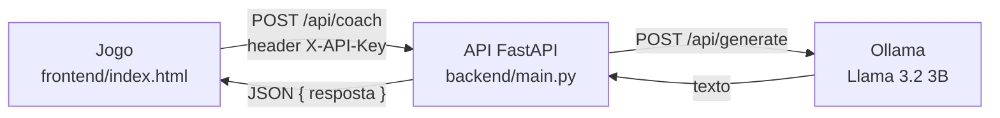

# ACE GAMER AND COACH

Jogo de tênis arcade 2D com um treinador de IA, o **COACH-A1**. Durante a partida, o Coach lê o jogo e orienta onde mirar e qual raquete usar. O texto do Coach é gerado por um modelo de linguagem, o **Llama 3.2 3B**, que roda localmente pelo **Ollama**.

## Integrantes do Grupo

| Nome | RM |
|---|---|
| GEANDRO | 562316 |
| LUCAS VERO | 564202 |
| ROBERTO EDUARDO | 564537 |

Este repositório é a entrega da matéria de **Front-End**. O projeto foi separado em duas partes:

| Pasta | O que é | Tecnologia |
|---|---|---|
| [`frontend/`](frontend/) | O jogo inteiro (telas, gameplay, painel do Coach) | HTML, CSS e JavaScript puro, sem framework |
| [`backend/`](backend/) | API que recebe o pedido do jogo e conversa com o modelo | Python + **FastAPI** |

## Vídeo de demonstração

[https://youtu.be/jEYTOe-YSb0](https://youtu.be/jEYTOe-YSb0)

## Como funciona



1. A cada saque, quando o jogador pergunta algo no chat e no intervalo entre games, o jogo monta um prompt com os dados da partida (placar, fôlego, mapa de movimentação do adversário).
2. O jogo envia esse prompt para a API (`POST /api/coach`) com a chave no header `X-API-Key`.
3. A API confere a chave, repassa o prompt ao Ollama e devolve o texto gerado.
4. O jogo valida a resposta (descarta texto longo demais ou com números inventados) e mostra a frase com a etiqueta verde **GERADO PELO MODELO AO VIVO**.

Se a API ou o Ollama estiverem fora do ar, o jogo continua normalmente: o Coach passa a responder pelo gerador local e a etiqueta fica cinza.

## O que instalar

| Para | Precisa de | Link |
|---|---|---|
| Jogar | Chrome ou Edge | |
| Rodar a API | Python 3.10 ou mais novo | https://www.python.org/downloads/ |
| Rodar o modelo | Ollama + modelo `llama3.2:3b` (cerca de 2 GB) | https://ollama.com/download |
| Rodar os testes do jogo (opcional) | Node.js 18 ou mais novo | https://nodejs.org/ |

## Como rodar (Windows)

São três passos, cada um no seu terminal.

### 1. Ollama (modelo)

```bat
ollama pull llama3.2:3b
```

Depois deixe o Ollama aberto. O app dele roda sozinho na bandeja do Windows; se não estiver aberto, rode `ollama serve`. Para conferir, abra http://localhost:11434 no navegador: deve aparecer "Ollama is running".

### 2. Backend (API)

```bat
cd backend
python -m venv .venv
.venv\Scripts\activate
pip install -r requirements.txt
copy .env.example .env
uvicorn main:app --reload
```

A API fica em http://localhost:8000. A documentação interativa (Swagger) fica em **http://localhost:8000/docs**, onde dá para testar a rota direto pelo navegador.

### 3. Frontend (jogo)

Abra `frontend/index.html` com duplo clique. Também funciona com o Live Server do VS Code.

No jogo:

1. Pule o vídeo de abertura e crie um login (3 letras ou mais) e uma senha (4 caracteres ou mais).
2. Clique no botão **Coach IA**. O endereço `http://localhost:8000/api/coach` já vem preenchido.
3. No campo da chave, digite `ace-coach-local`, que é o valor de `COACH_API_KEY` no `.env`.
4. Clique em **TESTAR CONEXÃO AGORA**. Deve aparecer **FUNCIONANDO** com o tempo de resposta.
5. Volte ao jogo, digite o nome do tenista e clique em **INICIAR PARTIDA**.

**Controles:** as setas movem o tenista, o mouse mira, o botão esquerdo faz a bola lenta e o botão direito, a bola rápida. Vence quem fizer 3 games.

> No Mac ou no Linux, os passos são os mesmos, trocando `.venv\Scripts\activate` por `source .venv/bin/activate` e `copy` por `cp`.

## A API em uma rota

`POST /api/coach`

| Header | Valor |
|---|---|
| `Content-Type` | `application/json` |
| `X-API-Key` | a chave definida em `COACH_API_KEY` (padrão `ace-coach-local`) |

Corpo:

```json
{ "prompt": "Responda apenas com a palavra FUNCIONANDO.", "max_tokens": 20 }
```

Resposta `200`:

```json
{ "resposta": "FUNCIONANDO", "modelo": "llama3.2:3b", "segundos": 1.84 }
```

| Código | Quando acontece |
|---|---|
| `401` | Chave ausente ou errada |
| `422` | Prompt vazio ou corpo inválido |
| `502` | O Ollama não está rodando ou devolveu erro |
| `504` | O modelo passou do tempo limite |

Teste rápido pelo terminal (PowerShell):

```powershell
Invoke-RestMethod -Method Post -Uri http://localhost:8000/api/coach `
  -Headers @{ "X-API-Key" = "ace-coach-local" } -ContentType "application/json" `
  -Body '{"prompt":"Diga oi em uma frase."}'
```

## Testes automatizados

| Parte | Como rodar | O que cobre |
|---|---|---|
| Backend | `cd backend` e depois `pytest` | 7 testes: chave ausente ou errada (401), resposta do modelo, escolha do modelo, prompt vazio (422), Ollama fora do ar (502) e CORS |
| Frontend | `cd frontend`, `npm install`, `npx playwright install chromium` e `npm test` | 21 testes: as mecânicas do jogo, o validador da IA, o fallback e o **jogo chamando a API FastAPI de verdade** (com a chave certa e com a chave errada) |

Os testes não precisam do Ollama, porque usam um servidor falso que responde no mesmo formato dele.

## Estrutura

```
ace-gamer-and-coach/
├── README.md               este arquivo
├── backend/
│   ├── main.py             a API (rota POST /api/coach)
│   ├── requirements.txt    dependências Python
│   ├── .env.example        modelo das configurações (copiar para .env)
│   └── tests/test_api.py   testes da API (pytest)
└── frontend/
    ├── index.html          o jogo completo (HTML, CSS, JS, imagem e vídeo embutidos)
    ├── prompts/            os 4 prompts que o jogo envia ao modelo
    ├── tests/              testes Playwright (jogo e integração com a API)
    └── package.json
```

## Problemas comuns

| Sintoma | Solução |
|---|---|
| O teste de conexão diz "Não consegui falar com a API" | O backend não está rodando. Rode `uvicorn main:app --reload` na pasta `backend` |
| Erro 401 no teste de conexão | Digite no jogo a mesma chave que está em `COACH_API_KEY` no `backend/.env` |
| Erro 502 no teste de conexão | O Ollama está fechado. Abra o app do Ollama ou rode `ollama serve` |
| Erro 502 citando "model not found" | Rode `ollama pull llama3.2:3b` |
| A etiqueta das dicas fica cinza durante o ponto | A dica tem limite de 4 s. Em máquina lenta, use um modelo menor: `OLLAMA_MODEL=llama3.2:1b` no `.env` |
| `uvicorn` não é reconhecido | Ative o ambiente virtual (`.venv\Scripts\activate`) antes |
