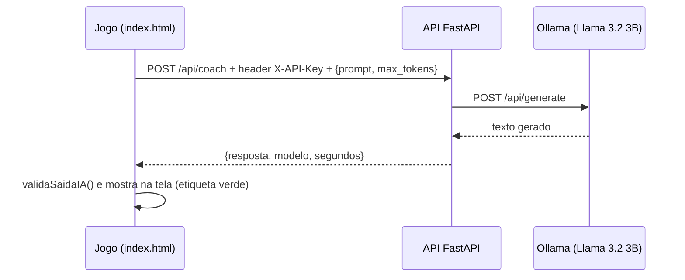

# ACE GAMER AND COACH: Frontend (o jogo)

Jogo de tênis arcade 2D com estratégia por rodada. O atleta treina com o **COACH-A1**, um treinador de IA que lê a partida e orienta onde mirar e qual raquete usar. As frases do Coach são geradas na hora pelo **Llama 3.2 3B**: o jogo envia um pedido à nossa **API em FastAPI** (pasta [`../backend`](../backend)), e é ela que conversa com o modelo.

## Integrantes do Grupo

| Nome | RM |
|---|---|
| GEANDRO | 562316 |
| LUCAS VERO | 564202 |
| ROBERTO EDUARDO | 564537 |

## Vídeo de demonstração

[https://youtu.be/jEYTOe-YSb0](https://youtu.be/jEYTOe-YSb0)

## Tecnologia

O jogo inteiro fica em um único arquivo, `index.html`, feito com **HTML, CSS e JavaScript puro**, sem framework e sem biblioteca externa:

| Parte | Como foi feita |
|---|---|
| Quadra, tenistas, bola e mapas | Canvas 2D, com o laço de jogo em `requestAnimationFrame` |
| Telas e painéis | HTML + CSS (abertura, login, menu, placar, painel do Coach, intervalo, letreiro final) |
| Sons | Sintetizados com a Web Audio API (sem arquivos de áudio) |
| Vídeo de abertura e imagem | Embutidos no próprio HTML, então o jogo funciona offline |
| Login, ranking e configuração | `localStorage` do navegador |
| Conversa com a IA | `fetch` para a API (`POST /api/coach`) com a chave no header `X-API-Key` |

## Modalidades de IA generativa

| Modalidade | Ferramenta | Onde aparece |
|---|---|---|
| Texto | Llama 3.2 3B via Ollama, chamado pela nossa API em tempo real | Dica de cada ponto, chat "Perguntas ao Coach" e análise do intervalo |
| Vídeo | Google Flow (gerado na produção) | Abertura do jogo e botão Trailer, com o crédito "VÍDEO GERADO POR IA" na tela |

## Telas

| Tela | O que tem |
|---|---|
| Abertura | Vídeo gerado por IA (dá para pular) |
| Login | Usuário (3 letras ou mais) e senha (4 caracteres ou mais), guardados no navegador |
| Menu / configuração | Nome do tenista, uniforme, raquete (AGRESSIVO ou TÉCNICO), estilo do adversário e quadra (dura azul, saibro ou verde), e o botão INICIAR PARTIDA |
| Gameplay | Quadra com grade de 24 quadrados, alvo de precisão, mira e zona "JOGUE AQUI". Placar e fôlego à esquerda; painel do COACH-A1, chat e mapas de calor à direita |
| Intervalo | 30 s entre os games, com a "Conversa do Coach" (análise do game) e troca de raquete |
| Fim de partida | Letreiro com resultado e placar, relatório final e ranking |

## Mecânicas

| # | Mecânica | Como funciona |
|---|---|---|
| M1 | Alvo e mira livre | Um alvo de dois anéis fica na frente do atleta. Bola no centro sai perfeita; no anel externo sai com erro; fora do alvo vai na rede |
| M2 | Dois estilos de raquete | **AGRESSIVO**: alvo pequeno, bola rápida, fôlego para um ponto só. **TÉCNICO**: alvo grande, bola mais lenta, gasta pouco e recupera fôlego ao acertar o centro |
| M2b | Bola rápida, lenta e efeito | Botão direito: bola rápida. Botão esquerdo: bola lenta, que ganha efeito quando sai do centro do alvo |
| M2c | Tipo de quadra | Dura azul, saibro ou verde |
| M3 | Adversário com os mesmos estilos | O adversário troca de estilo a cada game e tende a contrariar o estilo do jogador |
| M4 | COACH-A1 | Lê o mapa de movimentação do adversário e indica o quadrado "JOGUE AQUI", onde ele quase não pisa. Recomenda a raquete conforme o fôlego (nunca AGRESSIVO abaixo de 30%) |
| M5 | Resistência | Correr e bater gasta fôlego. Abaixo de 15% o tenista passa a se arrastar em quadra |
| M6 | Profundidade | A mira define se a bola cai curta ou funda. Bola curta ou lenta puxa o adversário para a rede; bola rápida e funda o empurra para o fundo |
| M7 | Ranking por obediência tática | Pontuação: 50 pela vitória + até 50 por seguir as dicas do Coach |

Vence quem fizer **3 games**.

## Como jogar

1. Abra `index.html` com duplo clique (Chrome ou Edge). Também funciona com o Live Server do VS Code.
2. Pule o vídeo, crie o login e a senha.
3. Para ligar a IA, clique em **Coach IA**:
   - o endereço `http://localhost:8000/api/coach` já vem preenchido;
   - no campo da chave, digite `ace-coach-local` (o valor de `COACH_API_KEY` no `backend/.env`);
   - clique em **TESTAR CONEXÃO AGORA** e espere aparecer **FUNCIONANDO**.
4. Digite o nome do tenista, escolha raquete, adversário e quadra, e clique em **INICIAR PARTIDA**.

**Controles:**

| Comando | Ação |
|---|---|
| Setas | Movem o tenista |
| Mouse ou touchpad | Mira |
| Botão esquerdo | Bola lenta (com efeito no centro do alvo) |
| Botão direito | Bola rápida |

Para a IA responder, o backend e o Ollama precisam estar rodando. Os passos estão no [README principal](../README.md). Sem eles o jogo funciona normalmente: o Coach usa o gerador local e a etiqueta das dicas fica **cinza**. Com a IA ligada, a etiqueta fica **verde** e mostra o tempo de resposta.

## Como o jogo conversa com a API



O código fica na seção **8. MODELO** do `index.html`:

| Função | O que faz |
|---|---|
| `endpoint()` | Lê o endereço, o modelo e a chave do painel Coach IA |
| `montaChamada()` | Monta os headers e o corpo da requisição (`X-API-Key` + `{prompt, max_tokens}`) |
| `callModel()` | Faz o `fetch` com tempo limite. Se der erro, devolve `null` e o gerador local assume |
| `textoDaResposta()` | Lê o campo `resposta` do JSON da API |
| `validaSaidaIA()` | Descarta resposta vazia, longa demais ou com números que não estavam nos dados (alucinação) |
| `testarCoachIA()` | Botão TESTAR CONEXÃO: explica em português o erro 401 (chave), 502 (Ollama fechado) ou a API fora do ar |
| `aquecerModelo()` | Faz uma chamada ao iniciar a partida para o modelo já estar carregado na primeira dica |
| `registraIA()` | Registra cada chamada; o botão **BAIXAR REGISTRO DO COACH IA (CSV)** exporta esse registro |

Os pedidos ao modelo acontecem em três momentos, cada um com seu tempo limite:

| Momento | Prompt (pasta [`prompts/`](prompts/)) | Tempo limite |
|---|---|---|
| A cada saque | `01_dica_do_ponto.txt`: frase que justifica o quadrado "JOGUE AQUI" | 4 s |
| Chat "Perguntas ao Coach" | `02_chat_perguntas_ao_coach.txt`: resposta à pergunta digitada | 6 s |
| Intervalo entre games | `03_analise_do_intervalo.txt`: análise do game e raquete recomendada | 7 s |
| Botão TESTAR CONEXÃO | `04_teste_de_conexao.txt` | 25 s |

Os trechos `${...}` nos prompts são preenchidos com os dados da partida (placar, fôlego, mapa de calor do adversário).

**Segurança:** nenhuma chave está no código. A chave é digitada no jogo e nunca é salva; só o endereço e o modelo ficam guardados no navegador.

O jogo também aceita o Ollama direto (`http://localhost:11434/api/generate`) ou uma API no formato OpenAI (`/v1/chat/completions`).

## Testes automatizados

```bat
npm install
npx playwright install chromium
npm test
```

São 21 testes em Playwright:

| Arquivo | O que cobre |
|---|---|
| `tests/mecanicas.spec.js` | Menu, mecânicas M1 a M7, vitória e derrota |
| `tests/ia.spec.js` | Validador da IA, integração, fallback com a API fora do ar, configuração salva sem a chave, vídeo de abertura |
| `tests/api.spec.js` | O jogo chamando a **API FastAPI de verdade** (sobe o `uvicorn`), com a chave certa e com a chave errada |

Os testes não precisam do Ollama, porque usam um servidor falso que responde no mesmo formato dele. Os testes de `api.spec.js` precisam das dependências do backend instaladas; sem elas, esses dois testes são pulados. Se o Python estiver num ambiente virtual, informe o caminho em `PYTHON`, por exemplo `set PYTHON=..\backend\.venv\Scripts\python.exe`.

## Arquivos

```
frontend/
├── index.html            o jogo completo (HTML, CSS, JS, imagem e vídeo embutidos)
├── prompts/              os 4 prompts que o jogo envia ao modelo
├── tests/                testes Playwright
├── package.json          dependência de teste (Playwright)
└── playwright.config.js
```
